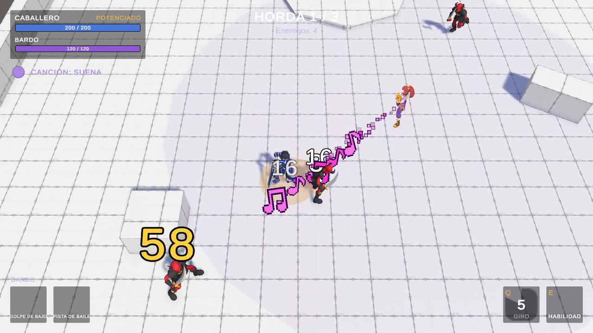
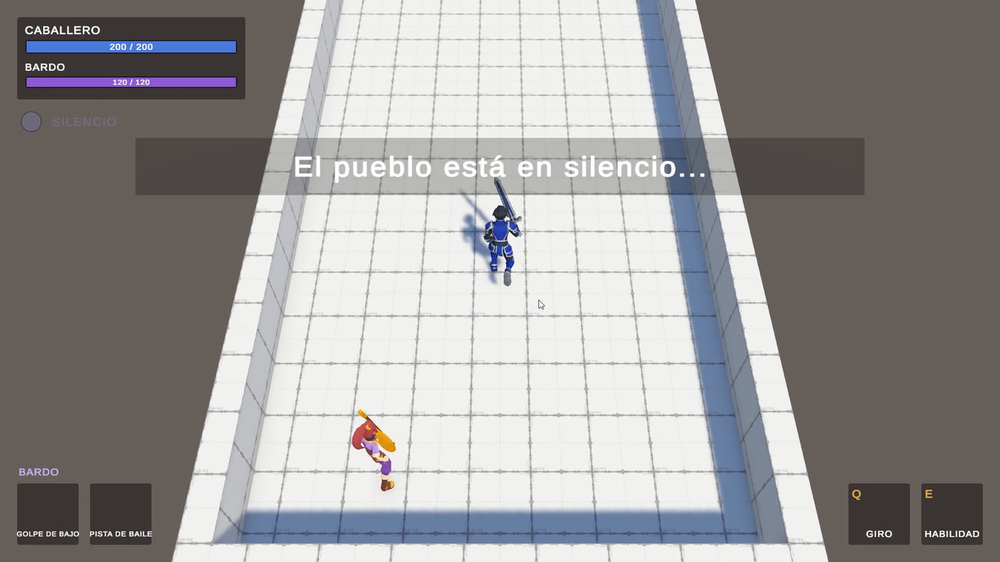
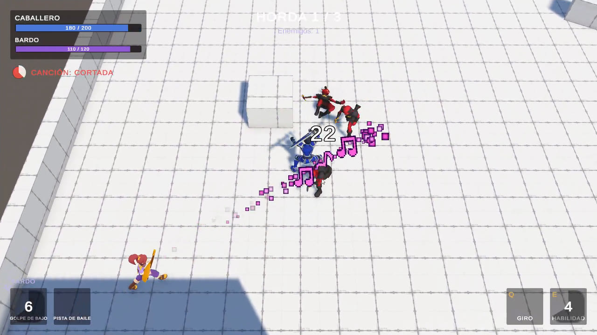
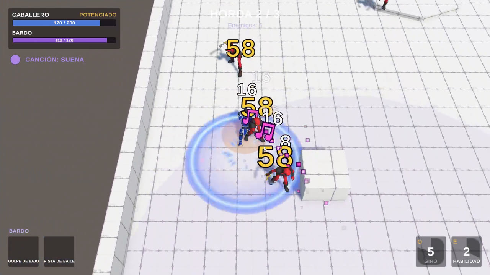
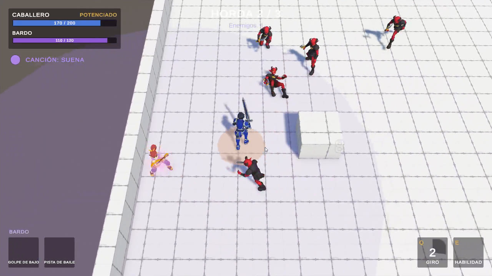

# El Último Compás

**The Last Beat** es un RPG de acción en tiempo real con cámara cenital, hecho en Unity 6 (URP). Es el proyecto final del curso Desarrollo de Videojuegos de la Universidad del Valle.



Esta es la **primera entrega (v0.1)**: un tramo jugable de principio a fin, con el caballero, la bardo controlada por IA y tres hordas de soldados demonio.

## De qué trata

En este mundo la magia nace del ritmo. El Rey Demonio quiere silenciarlo para rehacerlo a su manera, y un grupo de héroes sale a impedirlo. En esta entrega aparecen dos:

- **El caballero** es el personaje del jugador. Pelea cuerpo a cuerpo con un combo de tres golpes y dos habilidades.
- **La bardo** pelea sola. Mientras su canción suena (un dembow en 8 bits), el caballero está potenciado: hace más daño, sus golpes alcanzan más lejos y a veces esquiva un golpe sin que el jugador haga nada. Si un enemigo la golpea, la canción se corta y la potenciación se pierde hasta que ella vuelve a cantar.

Por eso no basta con atacar: hay que mantener a los demonios lejos de la bardo para que la música no pare.

## Qué incluye la v0.1

| Parte | Qué hay |
|---|---|
| Nivel | Menú principal y el nivel "Pueblo", con el escenario todavía en bloques de prototipo. Se llega en silencio, el combate empieza al entrar a la plaza y hay tres hordas. |
| Final | Victoria al superar la última horda y derrota si cae el caballero o la bardo. Desde la pantalla final se puede reintentar o volver al menú. |
| Caballero | Combo de tres golpes, Giro (golpea todo lo que tiene alrededor y termina en una explosión) y Embestida (carga en línea recta). |
| Bardo | Sigue al caballero y se aleja de los enemigos cercanos. Dispara notas, empuja con el Golpe de bajo y cura con la Pista de baile. |
| Enemigos | Soldado demonio: persigue al héroe más cercano, prefiere a la bardo si la tiene cerca y avisa en el suelo antes de golpear. |
| Interfaz | Vida de los dos héroes, estado de la canción, recarga de las habilidades, horda actual y números de daño y de curación. |
| Audio | La canción en tres capas que entran una por una, el viento del pueblo y los efectos de sonido. Todo está generado con código. |

## Capturas

| | |
|---|---|
|  |  |
| El pueblo en silencio, antes de entrar a la plaza. | Un golpe a la bardo corta la canción y el caballero pierde la potenciación. |
|  |  |
| La explosión que cierra el Giro. | La segunda horda rodea al caballero mientras la canción sigue sonando. |

## Controles

| Acción | Teclado y ratón | Mando |
|---|---|---|
| Moverse | WASD o flechas | Stick izquierdo |
| Atacar (combo de tres golpes) | Clic izquierdo o J | Botón izquierdo (X en Xbox) |
| Giro | Q o clic derecho | Botón superior (Y en Xbox) |
| Embestida | E | Botón derecho (B en Xbox) |

La bardo no se controla: se mueve, ataca y usa sus habilidades sola.

Todavía no hay menú de pausa. Para salir a mitad del nivel, Alt + F4.

## Jugar sin Unity

1. Descarga `TheLastBeat-v0.1-windows.zip` desde la sección [Releases](../../releases) del repositorio.
2. Descomprime la carpeta completa y abre `The Last Beat.exe`.

Funciona en Windows 10 y 11 de 64 bits. Como el ejecutable no está firmado, Windows puede mostrar un aviso azul la primera vez: `Más información` y luego `Ejecutar de todas formas`.

## Abrir el proyecto

Se necesita:

- **Unity 6000.3.28f1** (Unity 6.3 LTS), instalado desde Unity Hub.
- **Git con Git LFS.** Los modelos, las texturas y el audio están guardados en LFS.

```
git lfs install
git clone <URL de este repositorio>
```

Después, en Unity Hub: `Add` → `Add project from disk`, elige la carpeta clonada y ábrela. La primera importación tarda varios minutos. Para jugar desde el editor, abre `Assets/_Project/Scenes/MainMenu.unity` y pulsa Play.

Si al abrir faltan modelos, texturas o sonidos, el clon se hizo sin LFS. Se arregla ejecutando `git lfs pull` dentro de la carpeta del proyecto.

## Organización del proyecto

Todo lo propio del juego está en `Assets/_Project`:

| Carpeta | Contenido |
|---|---|
| `Art` | Concept art y modelos 3D con sus animaciones. |
| `Audio` | Música, ambiente y efectos de sonido en WAV, y el Audio Mixer. |
| `Input` | `GameControls.inputactions`, con los controles de la tabla de arriba. |
| `Materials`, `Prefabs`, `VFX` | Materiales, prefabs (soldado, números de daño) y efectos de las habilidades. |
| `Scenes` | `MainMenu` y `Pueblo`. |
| `ScriptableObjects` | Datos de las habilidades y de las hordas. |
| `Scripts` | Código en C#, con un namespace `TheLastBeat.*` por carpeta. |

El menú **The Last Beat** del editor monta en la escena abierta los personajes, sus efectos, el HUD y el audio.

## Créditos

**Equipo:** Kevin Aristizabal, Alejandro Villamil y Sebastian Rey.

- **Concept art:** imágenes generadas con IA a partir de los diseños del equipo.
- **Modelos 3D:** generados con Tripo3D a partir del concept art.
- **Esqueleto y animaciones base:** Mixamo (Adobe). Las animaciones de las habilidades se hicieron en Blender sobre ese mismo esqueleto.
- **Música, ambiente y efectos de sonido:** generados con código para este proyecto, sin material de terceros. El detalle está en [CREDITS.md](CREDITS.md).
- **Herramientas:** Unity 6 (URP, Input System, TextMesh Pro), Blender y Claude (Anthropic) como asistente de programación y de audio.
